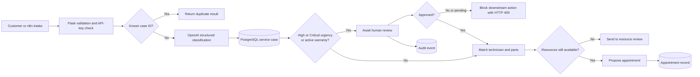

# Service Operations Control Tower — case study

## The operational problem

Service requests arrive as unstructured customer messages, but the next action depends on several facts: urgency, warranty state, technician capability, parts availability and whether a person has reviewed a risky case. A workflow that only classifies text can create a dangerous shortcut if later steps trust the classification without checking the recorded review decision.

This portfolio prototype turns a fictional EV service report into a structured case, routes risky cases to review, checks resources and proposes an appointment only when the recorded state permits it.

It is not a vehicle diagnostic system, emergency service, warranty adjudicator or measured customer deployment.

## Architecture

## What was built

- Flask endpoints for intake, approval, resource matching and appointment proposals.
- PostgreSQL tables for cases, technicians, parts, appointments and audit events.
- Structured OpenAI output validation with a fixed urgency vocabulary.
- Human-review routing for High/Critical classifications or active-warranty cases.
- Server-side review gates on both downstream routes.
- Atomic review decision and audit writes in one transaction.
- Row locks to serialize competing decisions and proposals for the same case.
- Rechecks of technician availability and parts stock before a proposal.
- One-appointment-per-case database constraint and idempotent duplicate response.
- Health and database-readiness endpoints.

## The important failure that was fixed

The original approval endpoint cleared the review flag for both approval and rejection. Downstream routes did not enforce the recorded status, so a caller could reach resource matching or appointment logic after a rejection.

The deployed fix fails closed:

- pending review returns HTTP 409;
- rejected status returns HTTP 409 even if the review flag is already false;
- High/Critical or active-warranty cases require recorded approved status;
- unknown status or urgency returns HTTP 409;
- only a case currently awaiting review can receive a decision;
- a second or conflicting decision returns HTTP 409.

## Verification evidence

| Evidence | Result | Boundary |
| --- | --- | --- |
| Mocked/parametrized regression suite | 51 cases passed | Database and AI are mocked |
| Isolated PostgreSQL integration suite | 13 cases passed | Synthetic fixtures, AI mocked |
| Hosted GitHub checks | 2 checks passed | Python 3.13, PostgreSQL 17 and Docker build |
| Live Render deployment | Commit `7f39057` reached Live | No paid-AI intake or production mutation test |
| Live `/health` | `{"status":"ok"}` | Process availability only |
| Live `/ready` | `{"database":"ok","status":"ready"}` | Connectivity, not complete schema validation |

The SQL cases include pending/rejected blocking, approved and routine workflows, changed resources, audit rollback, concurrent conflicting decisions and concurrent duplicate appointment proposals.

## Three representative scenarios

1. **Routine screen problem** — Low urgency, inactive warranty. The case can proceed directly to resource matching. A proposal is allowed only after a matching available technician and required stock are recorded and rechecked.
2. **Battery warning with power loss** — High/Critical or active warranty. The case is stored as `awaiting_review`; resource matching and appointment proposals return HTTP 409 until an approval is recorded.
3. **Rejected or resource-changed case** — A rejected case stays blocked. An approved case is also blocked if its technician becomes busy or required stock reaches zero before the proposal.

Executable request sequences and expected state transitions are documented in [DEMO_SCENARIOS.md](DEMO_SCENARIOS.md).

## What this demonstrates

- Translating a business process into explicit states and guarded transitions.
- Treating model output as an input to workflow controls, not unquestioned authority.
- Using transactions, row locks and database constraints for concurrency-sensitive actions.
- Separating classification, human decision, resource validation and external action.
- Testing dangerous and ambiguous paths, not only the successful demonstration.

## Honest limitations and next work

- A shared API key is not role-based authentication; the reviewer name is caller supplied.
- AI classification can be wrong, and a misclassified dangerous report can still take the routine path.
- Classification failure returns a review response but does not persist a new case.
- Technician and parts matching are simple keyword/text matching.
- Availability checks do not reserve stock or a real calendar slot.
- Appointment timing uses a fixed offset and can conflict with the recorded Critical SLA.
- Intake duplicate checking is not fully protected against concurrent first submissions.
- There is no durable retry queue, failed-job replay interface or email-delivery ledger.
- No real users, time savings, revenue impact or production accuracy have been measured.

